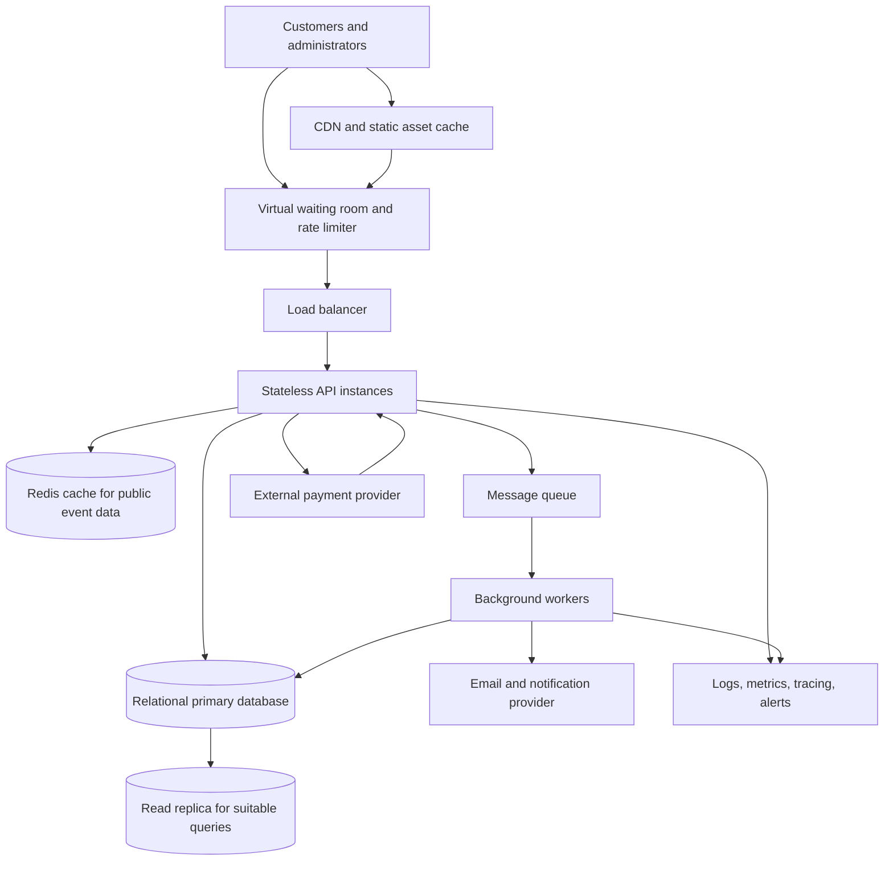

# TicketHub System Design

## 1. Requirements

### Functional requirements
1. Visitors can search and browse events by name, date, category, and venue.
2. Visitors can view event details, seating maps, prices, and current seat availability.
3. Registered users can select seats and place temporary holds on available seats.
4. Users can pay for held seats and receive confirmed orders and digital tickets.
5. Users can view their orders; administrators can create events, set prices, and monitor sales.
6. The system handles payment failures, cancellations, expired holds, and confirmation notifications.

### Non-functional requirements
- **Availability:** Browsing should remain available during on-sales; checkout must fail safely rather than oversell.
- **Performance:** Target event-page response under 2 seconds at the 95th percentile during normal traffic; seat-hold requests should usually complete within 1 second, excluding external payment time.
- **Scalability:** Handle 200,000 people attempting to buy 20,000 seats in 10 minutes.
- **Consistency:** Each seat for a specific event can have at most one active hold or completed sale.
- **Security:** Use HTTPS, secure authentication, authorization, rate limiting, and payment tokenization. Never store raw card details.
- **Reliability:** Monitor latency, errors, queue depth, payment failures, and database contention. Back up the database and test recovery.

## 2. Traffic and capacity estimates

### Normal day
Given 50,000 visitors/day, 10 page views per visitor, and 5,000 tickets sold/day:

- Page views/day = 50,000 × 10 = **500,000**.
- Average page views/second = 500,000 ÷ 86,400 ≈ **5.8**.
- Assume the busiest period is 5 times the daily average: approximately **29 page views/second** for initial planning.
- Average ticket sales = 5,000 ÷ 86,400 ≈ **0.058 tickets/second** (about 208/hour averaged over the day).

These are averages, not evenly distributed traffic. Announcements and sale times create peaks, so public event information should be cached and application instances should scale horizontally.

### Popular concert on-sale
Given 200,000 people trying to buy 20,000 seats in 10 minutes:

- Average arrival rate = 200,000 ÷ 600 seconds ≈ **333 people/second**.
- Demand is **10 people per available seat**.
- Each visitor may make several requests, so API requests/second can be much higher than 333. Start capacity planning around **1,000–2,000 requests/second**, then validate with load tests.
- Use a virtual waiting room to release users to checkout at a controlled rate. A queue position is not a ticket reservation.

The inventory limit is 20,000 seats. Excess demand must be queued or rejected, never oversold.

## 3. API design

Base path: `/api/v1`. Use HTTPS and JSON. Authenticated endpoints require a session or bearer token. Mutating requests should accept an `Idempotency-Key` so retries do not create duplicate orders.

| Method and endpoint | Purpose | Important behavior |
|---|---|---|
| `GET /events?date=&category=&q=` | Search events | Paginated and cacheable |
| `GET /events/{eventId}` | Get event details | Public read endpoint |
| `GET /events/{eventId}/seats` | Get seating map and availability | Snapshot may become stale |
| `POST /events/{eventId}/holds` | Hold selected seats temporarily | Atomic claim; `409 Conflict` if unavailable |
| `POST /holds/{holdId}/checkout` | Start checkout | Verify owner, expiry, and state; idempotent |
| `POST /payments/webhook` | Receive payment status updates | Verify provider signature; process idempotently |
| `GET /orders/{orderId}` | Get order status | Only owner or authorized admin may access |
| `GET /users/me/tickets` | List confirmed tickets | Authentication required |

### Example: create a hold

```http
POST /api/v1/events/evt_123/holds
Authorization: Bearer <token>
Idempotency-Key: unique-request-key
Content-Type: application/json

{
  "seatIds": ["A-10", "A-11"]
}
```

A successful response returns `201 Created`, a hold ID, and an expiry time. If either seat is unavailable, return `409 Conflict` and do not create a partial hold. Seat-map availability is advisory; the hold response is authoritative.

Typical errors: `400` invalid input, `401` unauthenticated, `403` forbidden, `404` not found, `409` seat/state conflict, `429` rate limited, and `500` unexpected server error.

## 4. Data model

### Tables and key fields
- **users** (`user_id` PK, `name`, `email` UNIQUE, `password_hash`, `created_at`)
- **venues** (`venue_id` PK, `name`, `address`, `capacity`)
- **seats** (`seat_id` PK, `venue_id` FK → venues, `section`, `row_label`, `seat_number`; UNIQUE on venue/section/row/number)
- **events** (`event_id` PK, `venue_id` FK → venues, `title`, `starts_at`, `on_sale_at`, `status`)
- **event_seats** (`event_id` FK → events, `seat_id` FK → seats, `price`, `status`, `hold_id` nullable, `hold_expires_at` nullable, `order_id` nullable; composite PK (`event_id`, `seat_id`))
- **holds** (`hold_id` PK, `user_id` FK → users, `event_id` FK → events, `status`, `expires_at`, `created_at`)
- **orders** (`order_id` PK, `user_id` FK → users, `event_id` FK → events, `hold_id` FK → holds, `status`, `total_amount`, `currency`, `idempotency_key` UNIQUE, `created_at`)
- **tickets** (`ticket_id` PK, `order_id` FK → orders, `event_id`, `seat_id`, `ticket_code` UNIQUE, `status`; FK (`event_id`, `seat_id`) → event_seats)

### Relationships
- One venue has many seats and many events.
- One event has many `event_seats` inventory rows; each row represents one seat offered for that event.
- One user can create many holds and orders.
- A hold can lead to at most one order.
- One confirmed order can contain many tickets.
- Each ticket references one event-seat inventory row, the source of truth for that seat's state.

### How the design prevents two people buying the same seat
The database—not the browser or cache—is the final authority.

1. Create exactly one `event_seats` row per `(event_id, seat_id)`, enforced by the composite primary key.
2. To hold a seat, start a transaction and atomically update its row only if it is `AVAILABLE`, or if its previous hold has expired. A conditional update can use: `UPDATE event_seats SET status='HELD', hold_id=?, hold_expires_at=? WHERE event_id=? AND seat_id=? AND (status='AVAILABLE' OR (status='HELD' AND hold_expires_at < CURRENT_TIMESTAMP))`. The operation must affect exactly one row. Concurrent requests cannot both claim the same row.
3. Claim all seats requested by one user in the same transaction. If any seat is unavailable, roll back all changes so the user does not get a partial hold.
4. Checkout verifies the hold belongs to the user, has not expired, and still owns the seats. After verified payment, a transaction conditionally changes the seats from `HELD` to `SOLD` and creates the order and tickets.
5. Use idempotency keys for checkout and payment webhooks. A worker releases expired holds, but only after checking that payment/order state permits release.

This protects against simultaneous requests. The seat map can briefly be stale, but the transactional database decides who gets the seat. If payment fails or times out, reconcile the payment state before releasing the hold.

## 5. Architecture diagram and component explanations



- **Customers/admins:** Browse events, choose seats, buy tickets, and manage event listings. Admin actions require authorization.
- **CDN:** Serves static assets close to users and reduces application load.
- **Waiting room/rate limiter:** Smooths sudden demand and admits users at a controlled rate. Queue position does not guarantee a ticket.
- **Load balancer:** Distributes traffic across healthy API instances.
- **Stateless API instances:** Validate requests and permissions, apply business rules, and coordinate holds, orders, and payments. They can scale horizontally.
- **Redis cache:** Speeds up public event information. It is not the source of truth for seat ownership.
- **Relational primary database:** Enforces transactions, constraints, and atomic seat-state changes. All seat claims are decided here.
- **Read replica:** Serves suitable read-heavy queries. Hold and checkout decisions use the primary database to avoid stale replica data.
- **Queue/workers:** Send confirmations, process background jobs, expire holds, and retry recoverable tasks.
- **Payment provider:** Processes payments; TicketHub stores payment references and status, not raw card data.
- **Monitoring:** Tracks latency, errors, queue depth, contention, payment outcomes, and incidents.

## 6. Trade-offs

### Strong seat consistency vs. maximum throughput
Transactions and atomic row updates can create contention when many users request the same seats. This may reduce throughput, but preventing duplicate sales is more important than accepting every request immediately. Keep transactions short, index lookup fields, control admission through the waiting room, and load-test contention.

### Virtual waiting room vs. immediate access
A queue adds friction and makes some users wait, but protects the API and database from a sudden surge. During a popular sale, stability and fair admission are preferable to allowing every visitor to hit checkout at once. Communicate queue status clearly and never imply a seat is reserved until the hold succeeds.

### Cache speed vs. freshness
Caching event descriptions and images reduces load, but seat availability can become stale. Cache public event data aggressively; treat seat maps as informational and confirm availability through the primary database when placing a hold.

### Synchronous checkout vs. asynchronous payment handling
Waiting for every external payment step can make checkout slow and fragile. Asynchronous processing is more resilient but requires states such as `PAYMENT_PENDING`, idempotent webhooks, and reconciliation. Never mark a ticket sold based only on a browser message; use verified provider status and a safe database transition.
